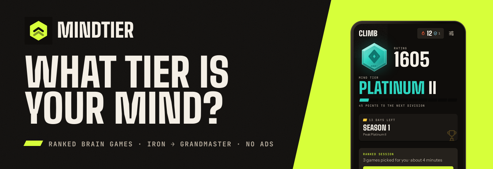
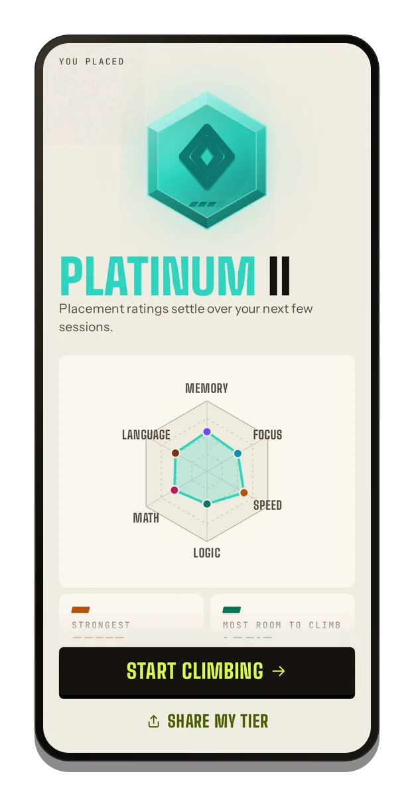
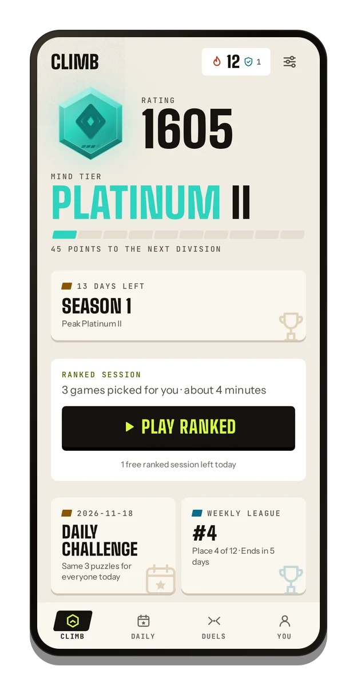
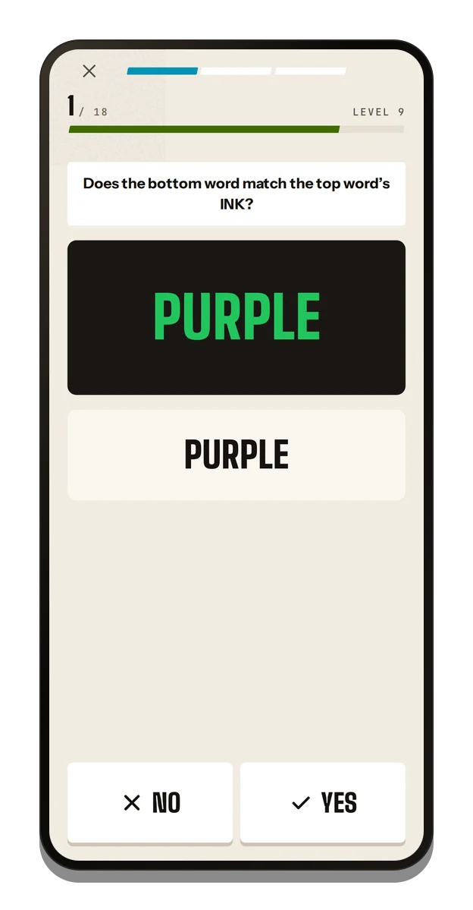
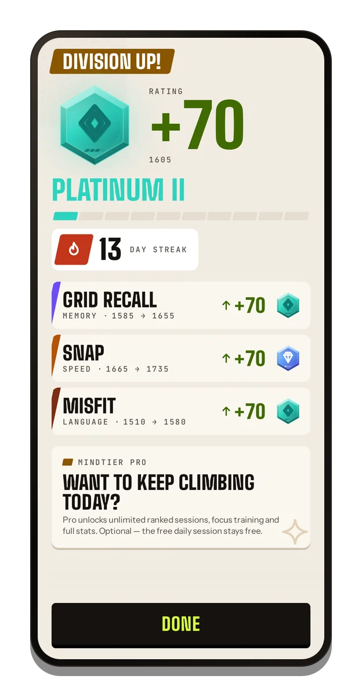
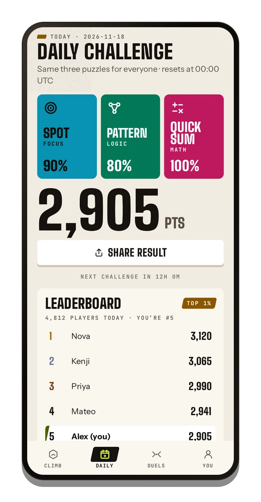
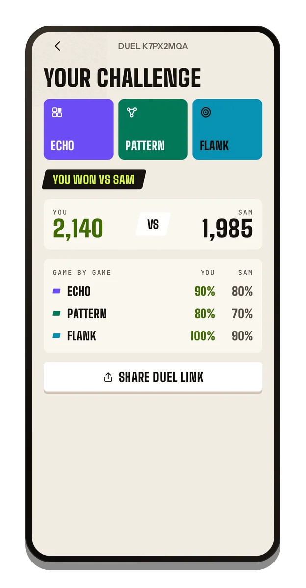
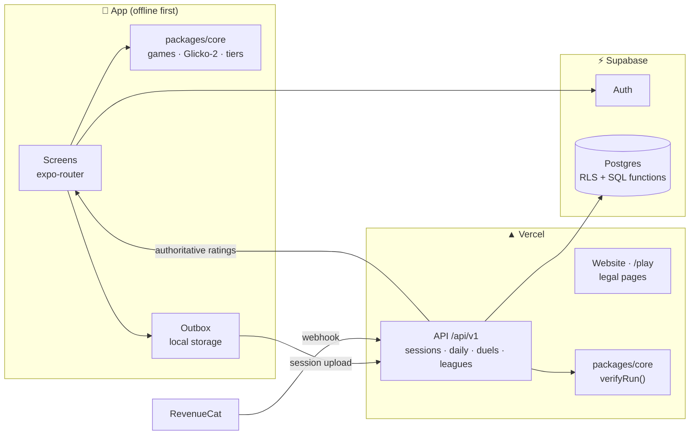

<div align="center">

<picture>
  <source media="(prefers-color-scheme: dark)" srcset="docs/readme/banner-dark.png">
  <source media="(prefers-color-scheme: light)" srcset="docs/readme/banner-light.png">
  
</picture>

### Ranked brain games. Find your tier, then climb.

[](https://github.com/Himkush1414/midas-engine/actions/workflows/ci.yml)
[](https://midas-engine.vercel.app/play)
[](#features)
[](#license)
<br>
[](https://expo.dev)
[](https://reactnative.dev)
[](https://www.typescriptlang.org)
[](https://nextjs.org)
[](https://supabase.com)

[**Play today's challenge in your browser →**](https://midas-engine.vercel.app/play)

</div>

<br>

<table align="center">
  <tr>
    <td align="center" width="33%">
      <picture>
        <source media="(prefers-color-scheme: dark)" srcset="docs/readme/screens/reveal-dark.webp">
        
      </picture>
      <br><sub><b>Place</b> · six games, one tier</sub>
    </td>
    <td align="center" width="33%">
      <picture>
        <source media="(prefers-color-scheme: dark)" srcset="docs/readme/screens/home-dark.webp">
        
      </picture>
      <br><sub><b>Climb</b> · one rating per skill</sub>
    </td>
    <td align="center" width="33%">
      <picture>
        <source media="(prefers-color-scheme: dark)" srcset="docs/readme/screens/game-clash-dark.webp">
        
      </picture>
      <br><sub><b>Play</b> · 15 adaptive games</sub>
    </td>
  </tr>
  <tr>
    <td align="center">
      <picture>
        <source media="(prefers-color-scheme: dark)" srcset="docs/readme/screens/results-tierup-dark.webp">
        
      </picture>
      <br><sub><b>Rank up</b> · every session counts</sub>
    </td>
    <td align="center">
      <picture>
        <source media="(prefers-color-scheme: dark)" srcset="docs/readme/screens/daily-dark.webp">
        
      </picture>
      <br><sub><b>Daily</b> · same puzzles for everyone</sub>
    </td>
    <td align="center">
      <picture>
        <source media="(prefers-color-scheme: dark)" srcset="docs/readme/screens/duel-dark.webp">
        
      </picture>
      <br><sub><b>Duel</b> · beat a friend's score</sub>
    </td>
  </tr>
</table>

## What it is

Mindtier turns brain games into a ranked ladder. Six short placement games — Memory, Focus, Speed, Logic, Math and
Language — give you a starting tier from **Iron** to **Grandmaster**. Every ranked session after that moves your
rating up or down.

Puzzles adapt to your level, so they are never too easy and never impossible. Ranks compare your skill at these games
with other players. They are not an IQ test or a medical assessment.

## Features

| | |
|---|---|
| **Ranked ladder** | Eight tiers with divisions, a Glicko-2 rating per skill, placement and promotions |
| **15 games, 6 skills** | Grid Recall, Path Trace, Echo · Flank, Clash, Spot · Snap, Match · Pattern, Balance, Route · Quick Sum, Estimate · Sort, Misfit |
| **Daily Challenge** | Three puzzles, identical for every player worldwide, a live leaderboard and a spoiler-free share grid. Also playable on the web |
| **Friend duels** | Send a link; both players get the exact same puzzles. Verdict and game-by-game breakdown |
| **Seasons and leagues** | Monthly seasons with a recap card, opt-in weekly leagues of up to 30 players at your tier |
| **Zen mode** | Untimed, unrated practice for every game |
| **Six languages** | English, Spanish, Portuguese, German, French and Italian — UI, word games, store listing and website |
| **Accessible** | Colour-free mode, reduced motion, large text, haptics and sound toggles, screen-reader labels |
| **Honest freemium** | No ads, ever. Results are always free; Pro adds more play, with trial terms on the button |

## How it works

Every puzzle is a pure function of `(seed, trial, level)`. That one rule powers most of the product:

- **Fair competition.** The Daily Challenge and duels hand everyone the same seed, so everyone sees the same puzzles.
- **Cheat-resistant ratings.** The server regenerates every trial from its seed, re-scores the answers, checks
  difficulty and timing, and only then recomputes the rating.
- **Offline first.** The app plays and rates locally, queues results in an outbox and reconciles with the server
  when it is back online.

Ratings use [Glicko-2](http://www.glicko.net/glicko.html). Each block of trials is a "game" against items rated by
difficulty, and a staircase keeps items near your level, so the rating converges quickly during placement and
settles afterwards.

## Built with

| | Layer | Technology |
|:---:|---|---|
|  | Mobile app | [Expo SDK 57](https://expo.dev), expo-router, EAS Build |
|  | UI | [React Native 0.86](https://reactnative.dev), React 19, Reanimated 4, react-native-svg, react-native-web |
|  | Language | [TypeScript 6](https://www.typescriptlang.org), shared engine in `packages/core` |
|  | Website and API | [Next.js 16](https://nextjs.org) route handlers, OG images |
|  | Hosting | [Vercel](https://vercel.com) |
|  | Auth and database | [Supabase](https://supabase.com) (anonymous auth, email OTP) |
|  | Data | Postgres with row-level security and SQL functions |
|  | Purchases | [RevenueCat](https://www.revenuecat.com) on Google Play Billing |
|  | Localization | Typed dictionaries in six languages, native locale config |
|  | Tests | Vitest (engine, API), Jest + Testing Library (app), SQL tests |
|  | End to end and QA | Playwright: core-loop e2e, screenshots, performance check |
|  | CI | GitHub Actions: typecheck, lint, tests, web build, database, e2e |

## Architecture



The same engine runs on the phone (instant, offline) and on the server (verification). The server never trusts a
client score: it replays the run from its seed.

## Getting started

Requirements: Node 24 (see `.nvmrc`) and npm 11.

```bash
npm install
cp .env.example .env.local      # fill in your own values; never commit this file
scripts/verify.sh               # typecheck, lint and tests for every workspace
```

Run the app in a browser (no native build needed):

```bash
cd apps/mobile
npx expo start --web
```

Run it on Android with a development build:

```bash
cd apps/mobile
npx eas-cli@latest build --profile development --platform android   # once
npx expo start --dev-client
```

Website and API:

```bash
cd apps/web
npm run dev
```

Database: `scripts/db-check.sh` applies every migration to a throwaway Postgres in Docker and runs the SQL tests.

## Project structure

```text
apps/
  mobile/     Expo app: screens (src/app), features, games, UI kit, i18n
  web/        Next.js: landing page in six languages, legal pages, duel links, API
packages/
  core/       Pure TypeScript engine shared by app and server
supabase/
  migrations/ Schema, row-level security and API functions
scripts/      Verify, ship, deploy, screenshots, store and README artwork, perf check
store/        Play listing graphics and screenshots, generated from the real UI
docs/         Design direction, store listing, Play compliance and console checklist, handoff
```

## Roadmap

- [x] Ranked ladder, 15 games, placement, Daily Challenge, duels, Zen
- [x] Seasons, weekly leagues, weekly recap, streak shields
- [x] Six languages across app, store listing and website
- [x] Web Daily Challenge at [`/play`](https://midas-engine.vercel.app/play)
- [ ] Google Play release (closed testing first)
- [ ] iOS release
- [ ] Live real-time duels
- [ ] More languages

## Contributing

This is the source of a commercial product, published for transparency. Bug reports and suggestions are welcome as
[issues](https://github.com/Himkush1414/midas-engine/issues).

For code changes: branch from `main`, keep commits small, run `scripts/verify.sh` (and `scripts/db-check.sh` for
database changes) and open a pull request. CI must be green before anything merges.

## License

Copyright © 2026 Manik Rana. All rights reserved.

The source is visible for reference. No licence is granted to copy, modify or distribute it.

## Credits

- Typefaces: [Big Shoulders](https://fonts.google.com/specimen/Big+Shoulders), [Instrument Sans](https://fonts.google.com/specimen/Instrument+Sans) and [JetBrains Mono](https://www.jetbrains.com/lp/mono/), all under the SIL Open Font License.
- Rating system: [Glicko-2](http://www.glicko.net/glicko.html) by Mark Glickman.
- Built on open source from the Expo, React Native, Software Mansion, Vercel and Supabase communities.

## Try it

<table>
  <tr>
    <td align="center" width="260">
      <a href="https://midas-engine.vercel.app/play"></a>
      <br><b>Play in your browser</b>
      <br><sub><a href="https://midas-engine.vercel.app/play">midas-engine.vercel.app/play</a></sub>
    </td>
    <td width="300">
      <b>Android</b>
      <br><sub>Coming to Google Play. A QR code for the store listing will appear here once it is live.</sub>
    </td>
  </tr>
</table>
